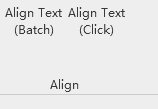
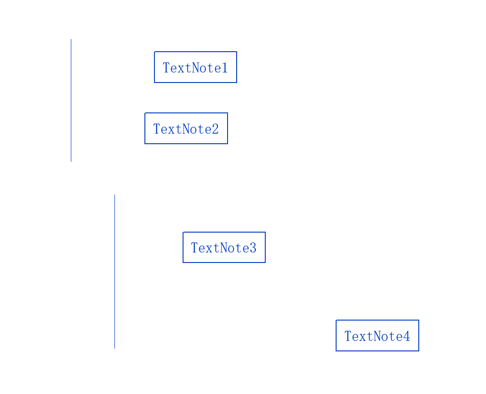
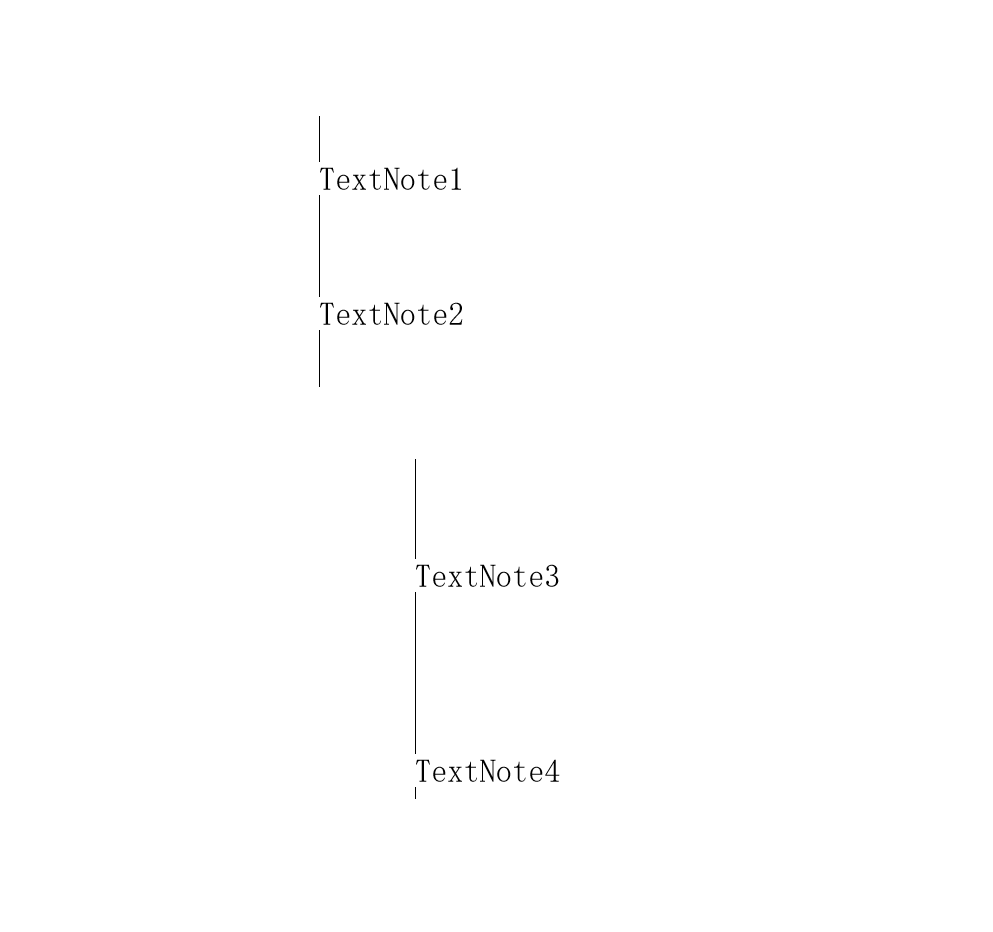
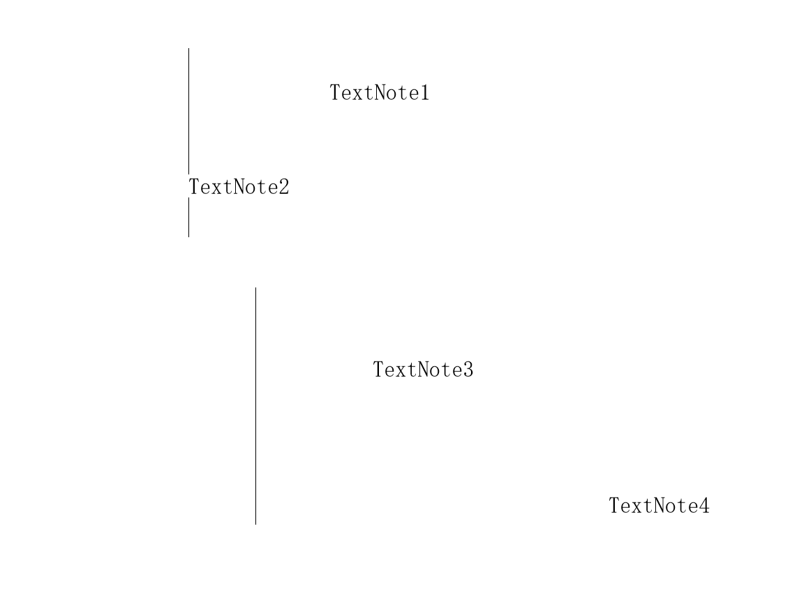

# Align Text to Line (Revit 2020) — User & Installation Guide

Moves text notes (TextNote) onto a reference line, perpendicular to it. Two buttons
give you two different ways to work; pick whichever suits the job.

---

## Table of Contents

1. [What it does](#1-what-it-does)
2. [Installation](#2-installation)
3. [Workflow (Batch mode)](#3-workflow-batch-mode)
4. [Workflow (Click mode)](#4-workflow-click-mode)
5. [Behaviour rules](#5-behaviour-rules)
6. [Message reference](#6-message-reference)
7. [Troubleshooting](#7-troubleshooting)
8. [Uninstall](#8-uninstall)

---

## 1. What it does

Projects each text note onto the reference line along the view normal — that is,
the text drops straight onto the line.

- Text position is read from `TextElement.Coord`
- Text angle is **not** changed (it does not follow the line)
- View-specific text only moves within the current view

Two ways to work. **They are two parallel features, not old and new versions of one:**

| Button | When to use it | Character |
|---|---|---|
| **Align Text (Batch)** | A batch of text against a few lines, done in one go | One mixed selection, press `Enter`, everything aligns at once |
| **Align Text (Click)** | Long jobs, adjusting as you look, frequent line changes | One click, one result — **there is never a "Done" button to press** |



**Figure 1-1**: The `Align` panel on the Ribbon — `Align Text (Batch)` on the left,
`Align Text (Click)` on the right.

---

## 2. Installation

### 2.1 Requirements

- Revit **2020** (other versions untested)
- 64-bit Windows

### 2.2 Steps

1. **Exit Revit completely.**

   > Confirm in Task Manager that no `Revit.exe` process remains — Revit only
   > scans the add-in folder **at startup**, so closing the document is not enough.

2. **Copy both files into the add-in folder:**

   ```
   Source (as downloaded):  RevitTextAlignment.dll
                           RevitTextAlignment.addin
   Target folder:           %APPDATA%\Autodesk\Revit\Addins\2020\
   ```

   `C:\Users\<your username>\AppData\Roaming\Autodesk\Revit\Addins\2020\`

   > **Both files must sit in the same folder.** The `.addin` refers to the
   > assembly by relative path (`<Assembly>RevitTextAlignment.dll</Assembly>`),
   > so splitting them breaks loading.
   >
   > **Do not** copy `RevitAPI.dll` / `RevitAPIUI.dll` in as well. Revit provides
   > those; a mismatched copy causes a load failure.

3. **Start Revit.**

4. **Confirm the `Text Tools` tab appears** on the Ribbon with both buttons in it.


**Figure 2-1**: The Ribbon after a successful install. Seeing this panel means the
add-in loaded.

### 2.3 If the tab does not appear

Work through these in order:

| Check | How | Expected |
|---|---|---|
| Files in the right place | See step 2.2 | Both files in one folder |
| Revit really exited | Task Manager → `Revit.exe` | No process left |
| Startup error log | See [section 7](#7-troubleshooting) | The log content is the reason |

---

## 3. Workflow (Batch mode)

**Use when** a batch of text needs to go onto a few lines in one pass.

### 3.1 Steps

1. **Click `Align Text (Batch)`.**
   The cursor enters picking mode; the status bar shows a prompt.

2. **Mixed-select**: click the reference line(s) and every text note.
   - Hold `Ctrl` to add to the selection
   - Order does not matter — the plugin tells lines and text apart itself

3. **Press `Enter`** (or click `Done` in the status bar).
   All selected text aligns **simultaneously**.

4. **You are returned to picking mode** automatically. Repeat step 2 for the next batch.

5. **Press `Esc`** to finish.

### 3.2 Result

Before — two vertical reference lines, four text notes all sitting to the right:



**Figure 3-1**: Before aligning.

After pressing `Enter` — TextNote1 and TextNote2 sit on the upper line,
TextNote3 and TextNote4 on the lower one:



**Figure 3-2**: The result. **With multiple lines, each note binds to the nearest
line**, so the four notes split into two groups across two different lines.

---

## 4. Workflow (Click mode)

**Use when** you want to adjust as you look, switch lines often, and see exactly
what happened to each individual note.

### 4.1 Steps

1. **Click `Align Text (Click)`.**

2. **Click a reference line.**
   One click confirms it — **there is no "Done" to press**.

3. **Click a text note.** It **aligns immediately**.
   Click the next one, and so on.

4. **Need a different line? Just click the other line.**
   The reference line switches on the spot, and **every note after that aligns to
   the new line**. No need to `Esc` and go back a step.

5. **`Esc` means two different things:**
   - Pressed while picking text → ends the round, returns to step 2 (you can pick a
     different line and carry on)
   - Pressed while picking a line → exits the command for good

### 4.2 Result



**Figure 4-2**: The Click mode result — click notes one by one, each snaps onto the
line the moment it is clicked.

---

## 5. Behaviour rules

**There are no settings.** Behaviour is fixed:

| Situation | Behaviour |
|---|---|
| You picked a **line** (straight) | Treated as an **infinite line** — the short segment you see on a drawing is a direction reference, not a finite boundary |
| You picked an arc or other curve | Treated as a bounded curve; the note lands on the projected point |
| The perpendicular foot falls **outside** the curve | Snaps to the nearest point on that line (an endpoint) — you picked the line, so the note goes onto it; it is never skipped |
| The note is **already** at the target | Not moved (0.1 mm threshold, avoids jitter) |
| You picked a **wall / floor / roof** | **Not accepted.** Only detail lines (`DetailLine`) work |
| Text angle | **Unchanged** |

---

## 6. Message reference

### 6.1 On success — nothing is shown

The text moved; the effect is its own confirmation. This is deliberate: a success
message is noise.

### 6.2 On failure — always shown

When nothing moved, a bar appears at the bottom of the screen (dark red, fades out
after 2.8 seconds, does not steal focus).

| Message | Meaning and what to do |
|---|---|
| `No reference line picked. Pick a model line or a detail line.` | No line picked. Click a **detail line**, not a wall |
| `Picked N text note(s) but no reference line.` | Text was picked but no line. Add a line |
| `No text note picked. Pick the text you want aligned.` | Only a line was picked, no text |
| `Text 2584: Coord unavailable and get_BoundingBox returned null...` | That note's position could not be read. Usually means it is in an unusual state (pinned / inside a group / cross-view) |
| `Text 2584: cannot be projected onto any line (N candidate(s), position ...)` | Projection failed. The coordinates are in the log — use them to judge whether the right line was picked |
| `None of the N text notes could be moved. They may be pinned or restricted by worksets.` | The notes are **pinned** or restricted by **worksets** |

> The bar **does not steal focus**; clicks pass through to Revit and picking is not
> interrupted.
>
> The toast shows the English original, which says "model line or a detail line".
> The table above simplifies that to "detail line" — both refer to the same usable
> reference lines.

---

## 7. Troubleshooting

### 7.1 Log locations

| Log | Path | What it holds |
|---|---|---|
| **Run log** | `%LOCALAPPDATA%\RevitTextAlignment\align.log` | Every operation: what was picked, how each note bound, why anything was skipped |
| **Startup errors** | `%LOCALAPPDATA%\RevitTextAlignment.State\startup_error.log` | Only written if startup threw |

> These are **two different folders** (one carries a `.State` suffix).
> **Check both** when troubleshooting — looking at only one leads to the wrong
> conclusion.

### 7.2 Reading the startup log

| Log state | Meaning |
|---|---|
| **Has content** | `OnStartup` ran and threw; the content is the reason |
| **Empty / missing** | Rejected during load — `OnStartup` was never called at all. Check the signature, the bitness, and the `.addin` path |

### 7.3 Procedure

**Step 1: read the run log.** It spells out every step. A real excerpt:

```
--- start (batch mode)
round 1: lines=1 / notes=4 [DetailLine | DetailLine]
  view=Level 1 normal=(0,0,1) singleLineInfinite=True
    line[0] Line (3.086,5.823,0) -> (10.738,14.029,0) length 3420 mm
  batch plans=4 / unbound=0 / clampedToEndpoint=0
  batch moved=4
```

Seeing `plans=0 / unbound=1` tells you that step failed; the detail lines after
`unbound` state the exact reason.

**Step 2: run the diagnostic script.** Put `diagnose.ps1` in the same folder as the
add-in files:

```powershell
powershell -ExecutionPolicy Bypass -File .\diagnose.ps1
```

It writes `diagnose_out.txt` covering the file fingerprint, bitness, `.addin`
resolution, journal load records, signature status and more.

**Step 3: supply a screenshot.** With **Snoop Objects** (free Revit add-in)
installed, selecting a text note shows every field and value — more direct than
any log.

> **When reporting a problem, attach `align.log`.** Without it everything is guesswork.

---

## 8. Uninstall

1. Exit Revit completely
2. Delete both files from `%APPDATA%\Autodesk\Revit\Addins\2020\`
3. Delete the log folders (optional):
   ```
   %LOCALAPPDATA%\RevitTextAlignment\
   %LOCALAPPDATA%\RevitTextAlignment.State\
   ```
   > Licence state is kept in the `.State` folder. Deleting it resets the plugin to
   > its "no record" condition.